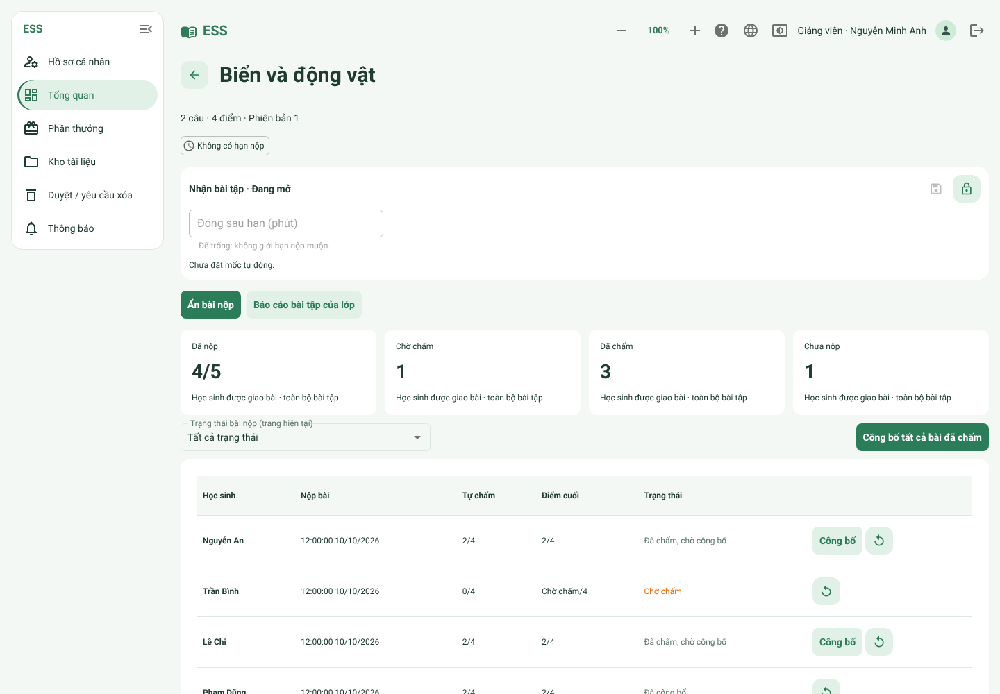
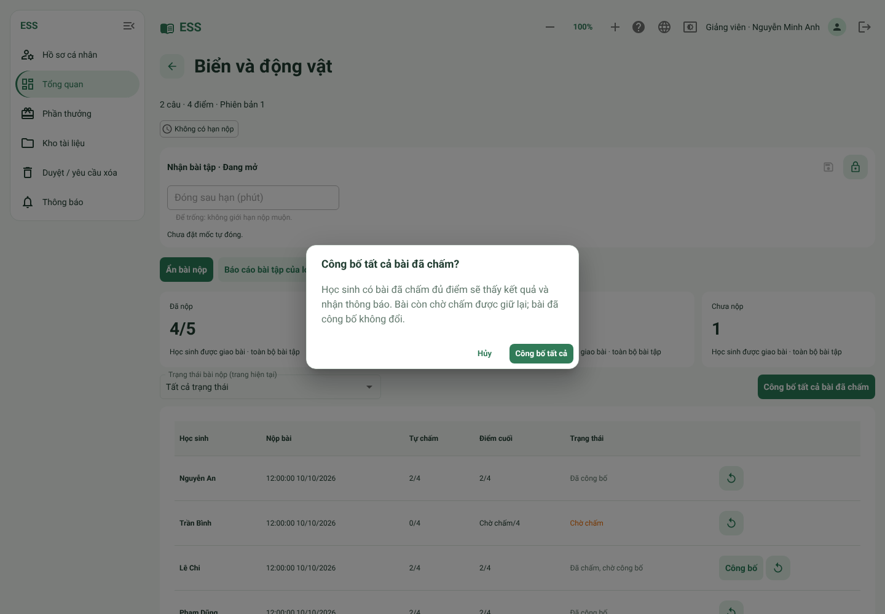
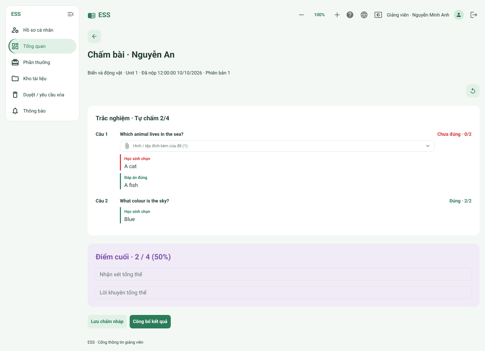
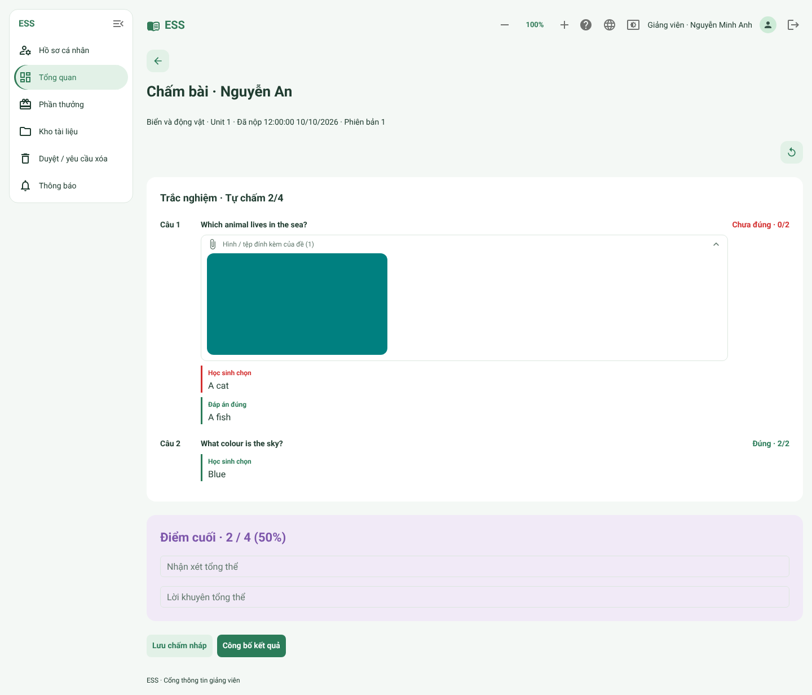
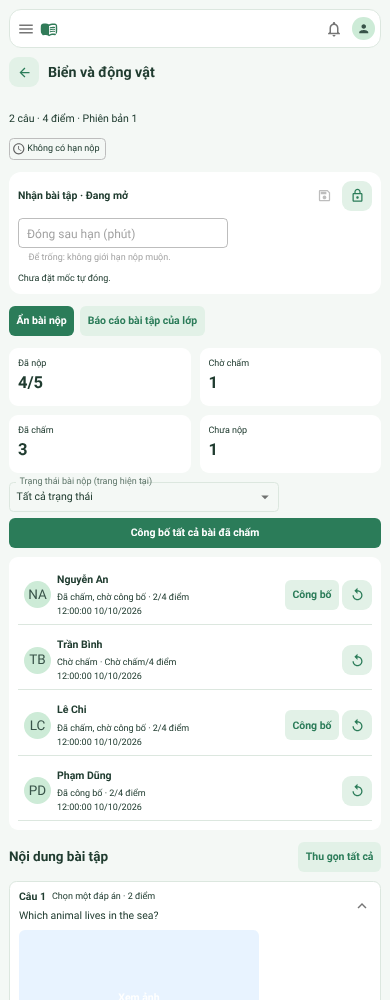
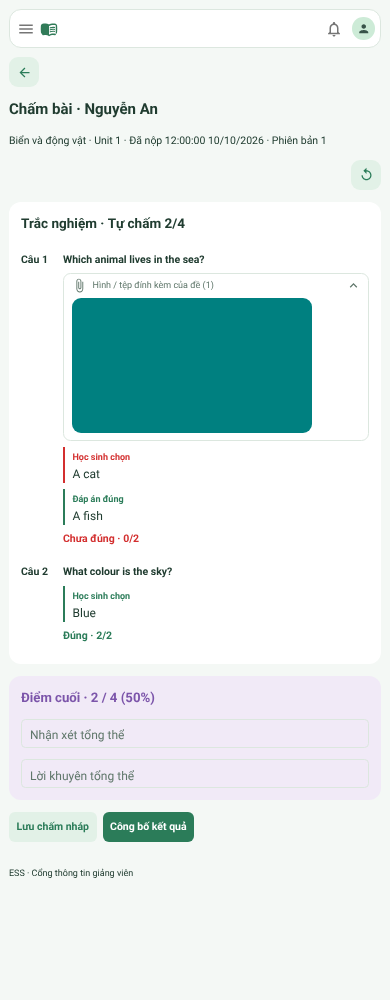

# Công bố kết quả bài tập và xem bài nộp

## Công bố từ danh sách bài nộp

- **Công bố tất cả bài đã chấm** (trên bảng bài nộp): hỏi xác nhận rồi gọi `POST /assignments/{id}/submissions/publish` một lần. API công bố mọi bài đã chấm đủ và chưa công bố trên tất cả các trang, gửi một thông báo; bài còn chờ chấm được giữ lại. Kết quả hiện ngay, ví dụ "Đã công bố 3 bài. 1 bài còn chờ chấm."
- **Công bố** ở cuối mỗi dòng có trạng thái "Đã chấm, chờ công bố": công bố riêng bài đó mà không cần mở trang chấm (dùng endpoint công bố từng bài sẵn có).
- Chỉ hiện với giảng viên có quyền sửa lớp. Không gian quản lý chỉ xem.

Cần backend có endpoint công bố hàng loạt (PR API "công bố toàn bộ kết quả đã chấm trong một request") trước khi deploy frontend này.

## Xem bài nộp

- Phần **Trắc nghiệm · Tự chấm** hiện nội dung từng câu hỏi, đáp án học sinh chọn, và khi chọn sai thì hiện thêm **Đáp án đúng**. Không chọn thì ghi "Không chọn đáp án".
- Hình/tệp đính kèm của đề (và của dữ kiện chung nhóm câu) nằm trong vùng **thu gọn mặc định**, ghi số lượng; mở ra mới tải media. Hình trong đáp án vẫn hiện vì đó là nội dung lựa chọn.
- Câu tự luận/bài nói/link dùng cùng vùng thu gọn cho media của đề.

Không thêm timer, polling hay request nền.

## Ảnh

|                                                                                     |                                                                                       |
| ----------------------------------------------------------------------------------- | ------------------------------------------------------------------------------------- |
|             |  |
|  |                  |
|               |                |
