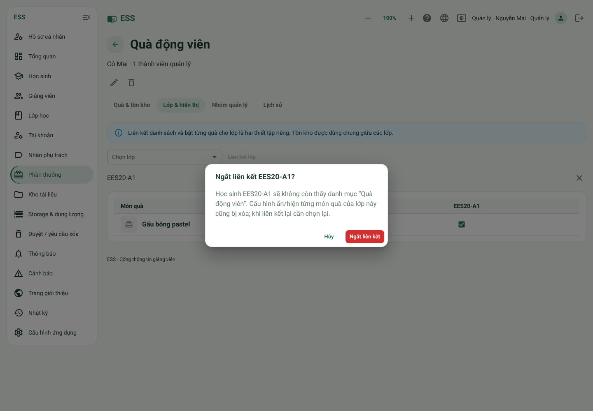
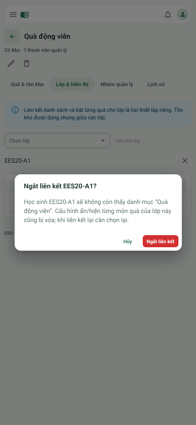
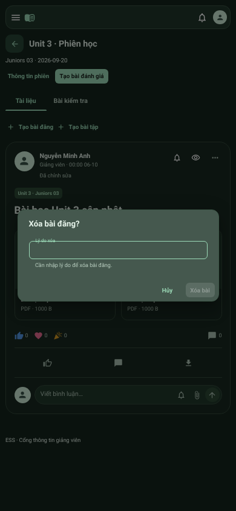
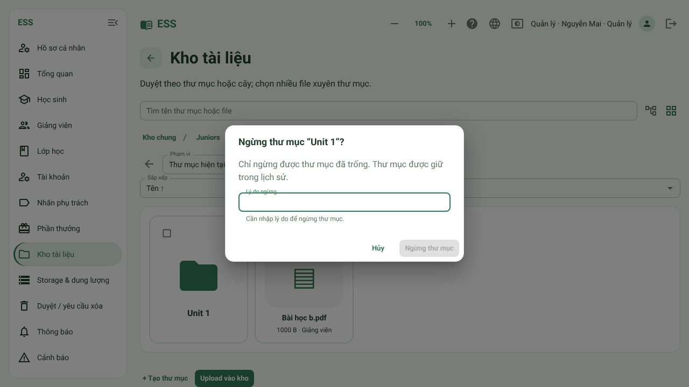
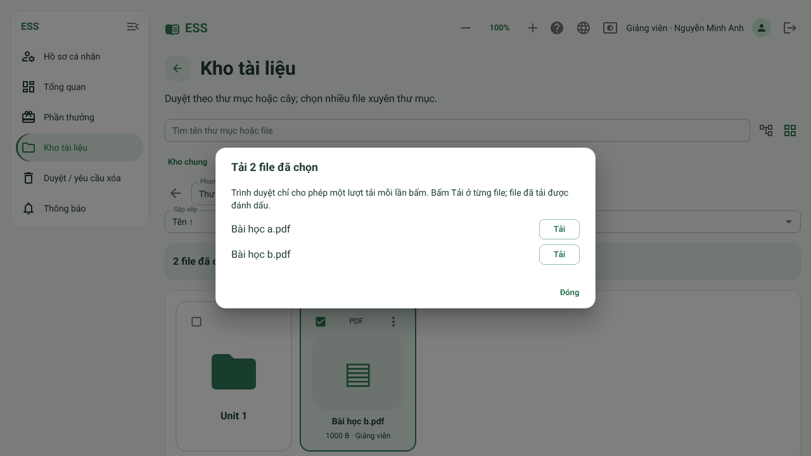
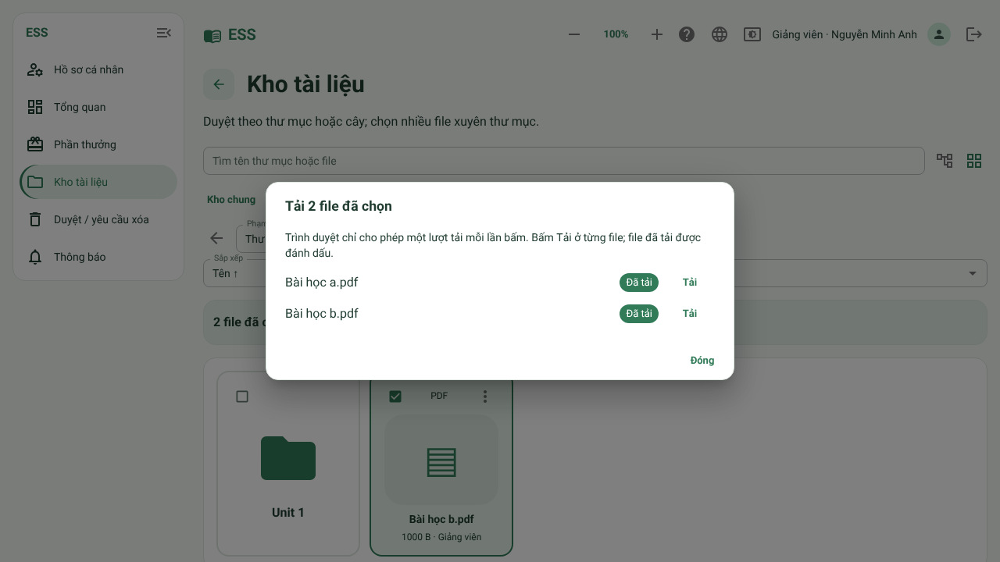
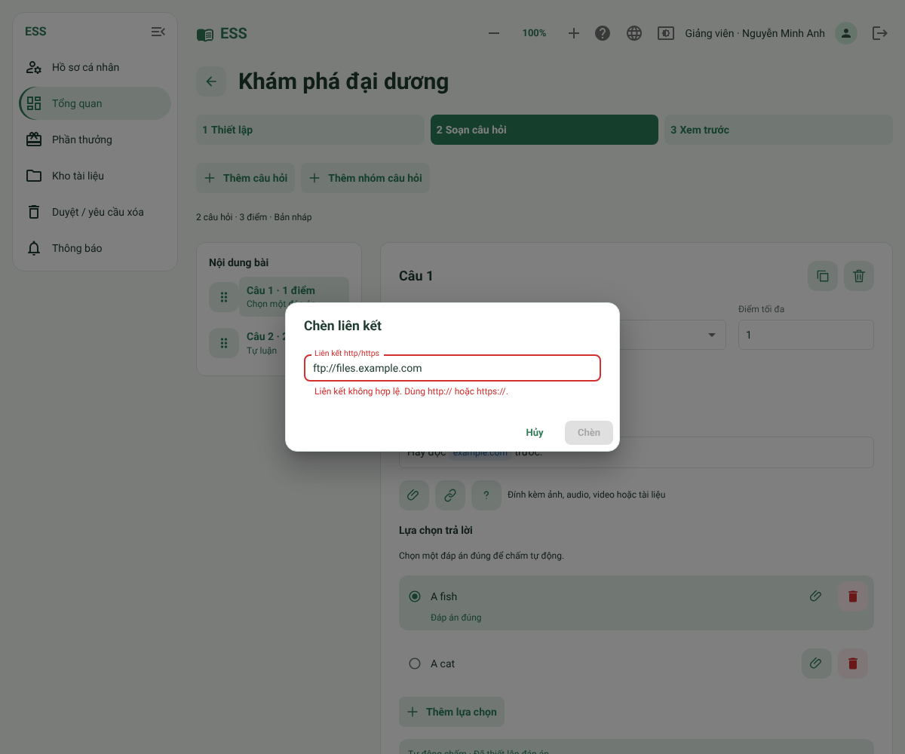
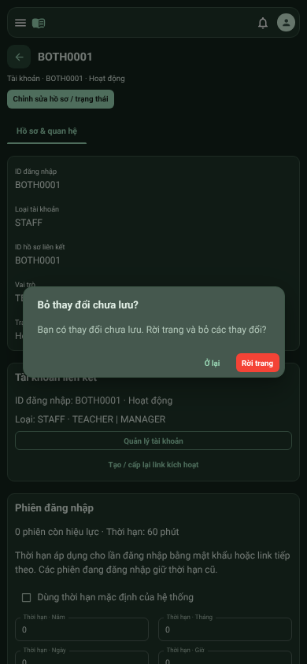

# Hộp thoại xác nhận trong ứng dụng

## Vì sao đổi

Staff Portal dùng `window.confirm`/`window.prompt` ở khoảng 40 chỗ. Hộp thoại của trình duyệt không theo giao diện sáng/tối, khó dùng trên điện thoại, và bị chặn trong trình duyệt nhúng (Zalo, Facebook): khi đó thao tác bị hủy âm thầm. Một số chỗ còn vô lý: bỏ trống lý do thì không có gì xảy ra và không báo gì; câu hỏi ngừng thư mục ghi "(phải rỗng)" khiến người dùng tưởng lý do phải để trống.

## Hành vi mới

- `src/shared/dialogs.tsx`: `askConfirm()` và `askText()` hiển thị hộp thoại MUI theo hàng đợi qua `<DialogHost/>` (gắn trong `theme/providers.tsx`). Theo giao diện sáng/tối, có nút hủy, nút xác nhận màu đỏ cho thao tác xóa/ngừng.
- Ô lý do bắt buộc: nút xác nhận bị khóa và có dòng giải thích khi còn trống; Enter để gửi. Có giới hạn độ dài và kiểm tra riêng (ví dụ liên kết chỉ nhận http/https).
- Cảnh báo rời trang khi chưa lưu (`confirmLeave`) dùng cùng hộp thoại cho link, nút quay lại, đổi tab, đổi không gian và nút Back của trình duyệt. Đóng/tải lại trang vẫn dùng cảnh báo `beforeunload` của trình duyệt (bắt buộc theo chuẩn web).
- **Ngắt liên kết lớp khỏi danh mục quà** giờ hỏi xác nhận và nói rõ cấu hình ẩn/hiện từng quà của lớp sẽ bị xóa.
- **Tải nhiều file đã chọn**: trình duyệt chặn nhiều lượt tải từ một lần bấm, nên chọn từ 2 file sẽ mở danh sách; mỗi file tải bằng một lần bấm và được đánh dấu "Đã tải". Một file vẫn tải ngay.
- Nút đóng hộp "Chọn tài liệu" trong soạn bài tập có nhãn cho trình đọc màn hình.

Không có timer, polling hay request mới; hộp thoại chỉ tồn tại khi đang hỏi. Không cần đổi backend, biến môi trường hay workflow.

## Kiểm thử

`e2e/support/app-dialog.ts` cung cấp `confirmAppDialog`/`cancelAppDialog`; các test cũ dùng `page.on("dialog")` đã chuyển sang hộp thoại mới. Test mới: xác nhận ngắt liên kết quà, danh sách tải nhiều file, lý do ngừng thư mục bắt buộc, kiểm tra liên kết khi chèn. Test socket nền chỉ đếm request do app gửi (fetch/xhr) và chờ trang chủ tải xong trước khi so sánh; test lịch ghim chờ tối đa 15 giây cho lượt làm mới sau tác vụ hàng đợi.

## Ảnh

| | |
|---|---|
|  |  |
|  |  |
|  |  |
|  |  |
